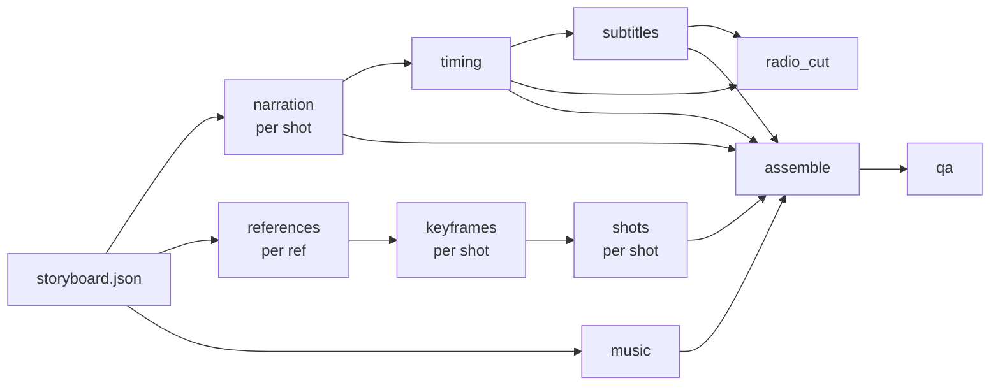
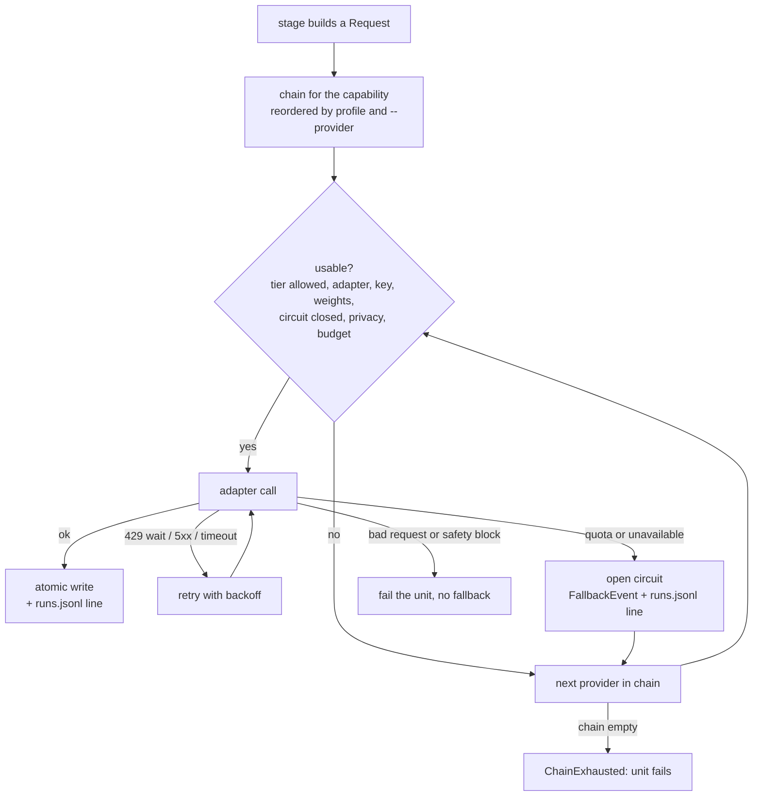

# Architecture

Tizita is a Python package (`tizita/`, CLI `tizita`) that turns one file, `storyboard.json`, into two
finished films (9:16 and 16:9). Every stage reads declared fields of that file plus the hashes of its
upstream artifacts, so a re-run regenerates only what changed. This document covers the stage graph,
the contract, caching, providers and failures, and assembly. The detailed plan is in `SPEC.md` §4–§10.
Where the code differs from the spec, this file describes the code.

## Repository layout vs. the brief

The brief suggests a shape "close to" a list of top-level files and folders, and invites improvements.
Every top-level item it names is here (`README.md`, `storyboard.json`, `schema/`, `runs.jsonl`,
`outputs/`, `DESIGN.md`, `ARCHITECTURE.md`, `EXPERIMENTS.md`, `FAILURES.md`, `COSTS.md`, `ETHICS.md`)
except one: **there is no `pipeline/` folder.** The stages are modules in `tizita/stages/`, run by
one scheduler.

| Brief: `pipeline/` stage | Here | What it does |
|---|---|---|
| script | `tizita/director.py` (`tizita new`) | A model drafts a beat sheet; code builds the schema-shaped storyboard, lints it and repairs it up to twice → `storyboard.draft.json` |
| keyframes | `stages/references.py`, `stages/keyframes.py` (shared helpers in `stages/images.py`) | Character/car sheet candidates → a human picks a golden one → per-shot keyframes conditioned on the goldens, gated by CLIP/DINOv2 similarity |
| shots | `stages/shots.py` | One clip per shot: Wan 2.2 i2v (paid, WaveSpeed) or Ken Burns (see "GPU executors") |
| music | `stages/music.py` | N score candidates; `tizita choose music N --reason` |
| narration | `stages/narration.py`, `stages/timing.py`, `stages/radio_cut.py` | One TTS take per shot; slot timing from the **measured** take lengths; the radio cut |
| assemble | `stages/subtitles.py`, `stages/endcard.py`, `stages/assemble.py`, `stages/qa.py`, `tizita/ffmpeg/graphs.py` | SRT/ASS, end card, mix + both exports, ffprobe/ebur128 QA |

Additions that have no place in the brief's list: `tizita/dag.py` (stage graph, dirty detection),
`tizita/cache.py` (cache keys, manifest), `tizita/runlog.py` and `tizita/events.py` (logs),
`tizita/providers/` (one router for every model call), `config/` (all parameters), `experiments/measure/` (re-runnable measurements), `tests/`.

**Why a package and not one script per stage.** The criteria that carry the most weight (caching, retries,
fallbacks, one `runs.jsonl` line per call, no secrets) are cross-cutting. Separate scripts would each
re-implement them or import them from a shared module anyway, and that shared module would be this
package. With one package, every stage gets the same cache, router and log writer, and the scheduler
knows the whole graph, so `tizita plan` can say exactly what an edit will regenerate. Running a single
stage, which is the main reason to have separate scripts, still works: `tizita run --stage <name>`
(and `--unit s04`, `--force`).

## Stage graph



The order in code is `dag.STAGE_ORDER`: narration, timing, subtitles, radio_cut, references,
keyframes, shots, music, assemble, qa. `director` is interactive and outside the graph. Each stage has a
`STAGE_VERSIONS` entry; bumping it invalidates that stage's cache when its code changes what it
produces.

Shot clips **do not depend on narration length.** Assembly fits each clip to its slot, so changing a
narration line costs one TTS call plus deterministic timing, subtitles and assembly (see the `plan`
excerpt below).

## The contract: `storyboard.json`

- **Schema:** `schema/storyboard.schema.json` (JSON Schema, authoritative). `tizita validate` checks it,
  and `make film` validates before running anything. `schema/runlog.schema.json` checks every
  `runs.jsonl` line at write time.
- **Semantic lint** (`tizita/storyboard.py`, `tizita lint [--json]`), beyond the schema: 8–12 shots,
  unique ids, a `reason` of 10+ characters on every shot; planned total 60–90 s, then the
  **measured** total once narration exists; words per second per shot (Ethiopic-aware word count,
  warning); every character, reference and cue id resolves; `real_person` references need a consent
  record (`ethics/consents.yaml`, `tizita/consent.py`); upload keyframes need an existing file;
  subtitle lines fit 2 × ~40 characters (warning); the `i2v` count fits the GPU budget (warning).
  Thresholds live in `config/pipeline.yaml`.
- **What each stage reads:** `dag.build_units` declares, per stage and unit, the exact storyboard
  fields (`fields`) and upstream artifacts (`upstream`). For example, narration for `s04` reads
  `shots[s04].narration.text_am` and `voice.*`, and keyframes read `keyframe.*`, the style block, the
  character blocks and the golden reference hashes.
- **Human choices are fields too:** `tizita choose reference <ref> <N>` and `tizita choose music N
  --reason` write `chosen` into the storyboard, so a pick is versioned, reviewable and part of the
  cache key of everything downstream.

## Caching

- **Key** (`tizita/cache.py`): `sha256(canonical_json({stage, stage_version, fields, upstream,
  provider, seed}))[:16]`. `fields` holds only the fields that stage declared. `upstream` holds the
  sha256 of the upstream artifact **bytes**, so a change propagates only if the upstream output
  actually changed.
- **Manifest** (`outputs/manifest.json`, committed): maps `(stage, unit)` → key, path, sha256,
  provider actually used, `is_fallback`, `primary_provider`, per-field hashes, candidates, run_id.
  The per-field hashes let `plan` say *which* field made a unit dirty.
- **Status per unit:** `cached`, `dirty: <field or upstream>`, `missing`, `fallback-upgradable`
  (a fallback output whose primary provider is available again; `tizita run --upgrade-fallbacks`
  re-renders them). An artifact whose provider is outside the active profile (e.g. a paid WaveSpeed
  clip under the free profile) stays `cached` with a note, because its inputs are unchanged;
  `--force` regenerates it.
- **Atomic writes:** artifacts are written to a temp file in the same directory and `os.replace`d
  (`tizita/util.py`), so an interrupted run never registers a half-written file. Superseded artifacts
  are pruned after a unit succeeds.
- **CI** runs `tizita plan --check` (exit 1 if anything is dirty) over the stages whose outputs are
  committed, so a clean clone provably needs zero model calls.

Real excerpt: the committed state is fully cached (`45 units: 45 cached`). With one narration
line edited (`shots[3]`, `s04`, in a scratch copy of the storyboard, `tizita plan --storyboard …`):

```
narration  s04      dirty: narration.text_am            Gemini 3.8 Flash TTS   8 s
timing     project  dirty: upstream narration/s04       deterministic          1 s
subtitles  project  dirty: upstream timing/project      deterministic          1 s
radio_cut  project  dirty: upstream timing/project, …   deterministic         20 s
assemble   project  dirty: upstream timing/project, …   deterministic         90 s
qa         project  dirty: upstream assemble/project    deterministic         15 s
45 units: 39 cached, 6 dirty. To run: 6 (≈ 2.2 min wall, 0 GPU min)
```

References, keyframes, shots and music stay cached: one model call, the rest deterministic.

Known limit: the narration cache check compares the provider name, not its params, so after changing
a TTS param (e.g. `style_mode`) use `tizita run --force --stage narration`.

## Providers, fallbacks and errors



Consent is checked before any call that depicts a real person.

- **One door for every model call:** stages build a `Request` and call the router
  (`tizita/providers/router.py`), never an SDK. Adapters live in `tizita/providers/`
  (`gemini_text`, `gemini_tts`, `cf_workers_ai`, `openai_compat`, `hf_ace_space`, `mms_tts`,
  `local_clip`, and the deterministic `synth_pad` and `previous_take`).
- **What is actually wired.** Chains list the planned catalogue. An entry with `adapter: null` is
  reported as unavailable and skipped, never faked:

  | Capability | Working adapters | `adapter: null` (not built) |
  |---|---|---|
  | text | Gemini ×3, Workers AI, Groq and OpenRouter (never called: no keys), paid Gemini (untested) | `storyboard_manual` |
  | tts | `gemini_tts`, `previous_take`, `mms_tts_local` | `gemini_tts_paid`, `mms_tts_space` |
  | image / image_edit | `cf_flux2_klein` (the reference path was used; upload repaint is untested), `cf_flux1_schnell` (image only, no references), `hf_flux` (ZeroGPU Space; built, but its only call hit the quota), `wavespeed_klein` (paid) | `local_flux`, `fal_image`, `previous_keyframe` |
  | i2v | `wavespeed_wan` (paid, Wan 2.2 i2v 480p/720p); Ken Burns is done by the `shots` stage itself | `kaggle_wan22`, `hf_wan_space`, `local_wan`, `fal_i2v` (`kenburns` is listed with no adapter) |
  | music | `hf_ace_space`, `synth_pad` | `kaggle_ace`, `local_ace`, `fal_music` |
  | embed / asr | `local_clip`, `cf_whisper`, `gemini_asr` | `skip_embed`, `groq_whisper`, `local_whisper` |
- **Chains** per capability are in `config/providers.yaml`, for example
  `tts: [gemini_tts, gemini_tts_paid, previous_take, mms_tts_space, mms_tts_local]` and
  `music: [kaggle_ace, hf_ace_space, local_ace, fal_music, synth_pad]`. Each entry declares its tier
  (`free_hosted | local | paid | deterministic`), quota pool and `accepts_private_media`. The config
  lint warns when two adjacent entries share a quota pool.
- **Profiles** (`config/profiles.yaml`): `free` (default), `free+local`, `local-first`, `paid`,
  `custom`; `--provider cap=id` puts one provider first. **Paid guard:** paid tiers need
  `ALLOW_PAID` **and** a positive `PAID_BUDGET_USD`, and the router stops at the budget.
- **Error taxonomy** (`errors.py`, `classify_http`) and what the router does:

  | Class | Action |
  |---|---|
  | `QuotaExhausted` | open the circuit until reset → next provider |
  | `RateLimited` | wait ≤ 30 s and retry once, else treat as quota |
  | `Transient` (5xx, timeout) | exponential backoff with jitter, max 3 tries → next provider |
  | `BadRequest` | fail fast, no fallback |
  | `SafetyBlocked` | fail the unit with the provider's message; no silent fallback |
  | `Unavailable` (not configured, no weights) | skip to the next provider |
  | `OutOfMemory` | retry once smaller → next provider |

- **Circuits** persist in `.state/circuits.json` (gitignored), so a dead provider is skipped for the
  rest of the run and for the next run until its reset. Gemini keys `GEMINI_API_KEY_1..N` rotate on a
  429 before the circuit sees the error.
- **Retries** re-seed: attempt *n* uses `seed + (n-1)*1000`, and the seed used is logged.
- **Privacy and consent:** providers with `accepts_private_media: false` never receive files from
  `refs/private/`; a `real_person` reference without a consent record is refused before any call.
- **Logging:** every attempt, failed ones included, writes one schema-checked line to `runs.jsonl`
  (run_id, stage, unit, provider, model, params, seed, attempt, cache key, output sha256, status,
  error class, `fallback_from`, latency, tier, list-price and actual cost; prompts as hash + first 200
  characters, never secrets). At the time of writing it holds 351 lines, 264 of them `ok`
  (breakdown: [COSTS](COSTS.md)). Every fallback also emits a `FallbackEvent` to the console (a yellow
  line), `logs/events.jsonl` and a draft entry in `logs/failures_auto.jsonl`, which is curated into
  `FAILURES.md`.

## GPU executors

Planned (SPEC §9): a `gpu_jobs/runner.py` job runner, the same code on Kaggle and locally, used by
`Local` and `Kaggle` executors for Wan 2.2 image-to-video and ACE-Step.

**Status: not built.** `tizita/executors/`, `tizita/gpu_jobs/` and `kaggle/wan_runner/` are empty
packages and placeholders. With the deadline close, the work was re-planned (see `docs/PROGRESS.md`)
to make the final cut certain first:

- **Shots:** under the free profile the `i2v` chain falls through to the deterministic `kenburns`
  provider. For the final film all 11 shots were animated by Wan 2.2 on WaveSpeed's paid API
  (`tizita/providers/wavespeed.py`, profile `paid`, behind the paid guard), after the free GPU paths
  were out of reach (FAILURES F-03, F-16). Those clips stay cached under the free profile.
- **Music:** the GPU is the hosted one. `hf_ace_space` calls a ZeroGPU Hugging Face Space running
  ACE-Step v1 3.5B (`victor/ace-step-jam`), because the official ACE-Step 1.5 Space answered "Model not
  fully initialized" and the official v1 Space failed server-side on 26 Nov (details in the
  `config/providers.yaml` comments and [EXPERIMENTS](EXPERIMENTS.md) EXP-11).

So the local pipeline needs no GPU: only the CPU models (MMS-TTS fallback, CLIP/DINOv2) run locally.
The hosted GPUs are WaveSpeed's (paid) and the Hugging Face Space's (free).

## Assembly

All FFmpeg filtergraphs are built by pure functions in `tizita/ffmpeg/graphs.py` and unit-tested on
the graph string. Parameters come from `config/assembly.yaml`. Exports use `-preset veryfast -crf 18`.

1. **Timing** (`stages/timing.py`): `slot = max(shot.duration_s, narration_len + lead + tail)`,
   crossfades overlap the slots, plus a 3 s end card. The measured total must be 60–90 s, otherwise
   the stage fails with advice ("trim s07 narration by ~6 words").
2. **Video:** each clip is fitted to its slot (Ken Burns clips are rendered at slot length; real i2v
   clips may be slowed down to 0.85× at most, then hold their last frame to the end of the slot;
   QA checks the frame count against the timing plan, FAILURES F-18), then graded, given light grain (`assembly.yaml`: 3,
   chosen by measurement), and joined with `xfade` cuts, crossfades or fades to black. Every chain ends
   in `fps=24,settb=AVTB`, because without it concat output has no frame rate and `xfade` fails.
3. **Audio:** takes are placed at their slot starts. `tizita/audio.py: speech_end_s` trims each take
   after the speech (30 ms fade). It was added for a noise burst that turned out to be our own
   double-wrapped WAV (FAILURES F-10); it stays as a guard. Music is ducked
   under the narration with `sidechaincompress` (EXP-05). This runs as two commands, because a single graph
   with `asplit` feeding the sidechain produced a silent branch. Then a two-pass `loudnorm` to
   −14 LUFS with a −2 dBTP target (a −1 target ends at −0.8 dBTP after AAC), and `-aac_pns 0` as a
   guard: with an untrimmed noise burst, PNS pushed true peak far above −1 dBTP (EXP-03).
4. **Subtitles** (`stages/subtitles.py`): SRT from `text_en`, two ASS styles (the 9:16 one sits
   higher to clear platform UI), burned per export, and `film.srt` exported too.
5. **End card** (`stages/endcard.py`): Pillow renders "Made with AI" in English and Amharic, the
   title, and credits listing the models actually used (read from the manifest).
6. **Exports:** 1080×1920 master and a 1920×1080 version (blurred, darkened fill behind the centred
   master), both in one FFmpeg pass. H.264 High, yuv420p, `+faststart`, 24 fps CFR.
7. **QA** (`stages/qa.py`): ffprobe (duration, resolution, fps, codecs) and `ebur128` (−14 ± 1 LUFS,
   true peak ≤ −1 dBTP) → `outputs/final/<key>/qa.json`. A failed check fails the unit, so
   `make film` exits non-zero. Current result: both films 77.2 s, −14.6 LUFS, −1.7 dBTP, pass.

The rendered MP4s are gitignored (≈ 90 MB each render); `qa.json`, `assemble.json` and `film.srt`
are committed as evidence.

## Failure handling

| Failure | What happens |
|---|---|
| A provider is out of quota, down or not configured | Router falls back down the chain, logs `fallback_triggered`, emits a `FallbackEvent`; the unit is marked `is_fallback` |
| Every hosted TTS fails | `previous_take` reuses that shot's last cached take before any local voice, so the voice never changes mid-film |
| Every music provider fails | `synth_pad` (deterministic FFmpeg chord pad) always answers |
| No i2v provider | `kenburns` renders the shot from its keyframe (free profile; the final film uses Wan clips for all 11 shots) |
| Music not chosen yet | Assembly uses candidate 1 and records a `degraded` event |
| Keyframe below the similarity gate | Up to 3 re-seeds, then the best attempt is kept and logged |
| Safety block or bad request | That unit fails with the provider's message; downstream units are skipped as "upstream not ready" |
| Interrupted run | Atomic writes mean nothing half-written is cached; the next run resumes from the manifest |
| Timing outside 60–90 s, or QA fails | The stage fails loudly with advice; no silent export |

Every degradation is listed in the run summary (`Run r_… done: N calls, N cache hits, N fallbacks`)
and in `assemble.json`. Not built: the SPEC's dark placeholder card for a *missing keyframe*. Today a
missing keyframe stops that shot and therefore assembly.

## Local pipeline vs showcase

The graded pipeline is the CLI: `make film` = `tizita validate` → `tizita run` → `tizita run --stage qa`,
on a clean clone with `.env` keys (or none: everything is cached, `make clean-clone-test` checks it).
It never depends on the API, worker, frontend or VPS. `tizita/api/`, `tizita/worker/`, `frontend/` and `deploy/` are reserved for an
optional showcase on top of the same stages; at the time of writing `tizita/api/` and
`tizita/worker/` are empty packages (cut behind the pipeline and docs in the re-plan).
